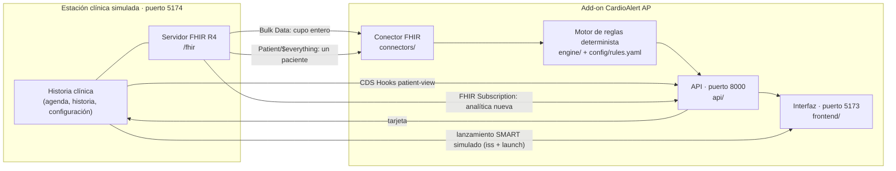

# CardioAlert AP

**Add-on para atención primaria que detecta el riesgo cardiovascular y renal oculto en el cupo, prioriza a los pacientes y se integra en el flujo de trabajo de la médica sin añadirle trabajo.**

Equipo 34 · The GOATS · Reto 1 «Automatizar lo repetitivo» (Hackathon Boehringer Ingelheim)

> Prototipo con **datos sintéticos**. No es un producto sanitario ni una herramienta oficial de ningún servicio de salud. La estación clínica que se ve en la demo es una simulación genérica.

Vídeo: (enlace pendiente)

---

## 1. El problema

Carmen es médica de familia. Tiene un cupo de unos 1.500 pacientes y 5-7 minutos por visita. Las analíticas de sus pacientes están repartidas entre atención primaria, el laboratorio del hospital, urgencias y, a veces, otra comunidad autónoma. Un paciente con cifras «aceptables» una a una puede estar perdiendo filtrado glomerular año tras año, tener una albuminuria que nadie ha valorado o un riesgo cardiovascular alto sin tratar. Nadie tiene tiempo de cruzar esos datos a mano, y revisarlo es trabajo repetitivo.

## 2. Qué hace

- **Lista «Hoy»:** los 10 pacientes pendientes más prioritarios del cupo, con el motivo en una línea y la acción sugerida.
- **Tarjeta en la historia clínica (CDS Hooks):** al abrir un paciente en la estación clínica aparece una tarjeta con el resumen, el motivo, el origen del dato y las acciones propuestas. Sin clics extra.
- **Ficha del paciente:** cada alerta explica por qué salta, con qué datos, de qué sistema vienen (p. ej. «dato cruzado entre eCAP - Catalunya y DIRAYA - Andalucía») y qué clase de recomendación la respalda. Incluye la evolución del FGe y de la albuminuria, una nota clínica en borrador y un volante.
- **Pruebas pendientes por lotes:** los pacientes crónicos sin UACR o creatinina reciente se agrupan en una sola petición conjunta (CSV o Excel) en lugar de ocupar la lista de trabajo.
- **Estados de cada alerta:** Pendiente, Citado, Revisado o Pospuesto hasta una fecha. Lo ya gestionado sale de «Hoy»; si aparece una alerta nueva, el paciente vuelve a Pendiente.
- **Actualización automática:** cuando entra una analítica nueva en la estación, el add-on recalcula solo ese paciente, aunque nadie lo abra.
- **Registro de actividad:** cada consulta, cálculo, cambio de estado y exportación queda registrado (quién, cuándo, qué paciente, qué acción).
- **Exportaciones:** cupo evaluado en Excel, pruebas pendientes en CSV/Excel y hoja de revisión clínica de las reglas.
- **Parámetros del protocolo:** los umbrales se pueden consultar y ajustar desde la interfaz, con validación y copia de seguridad.

## 3. Cómo funciona

El add-on **no tiene datos propios**. Los lee de la estación clínica con estándares de interoperabilidad, igual que lo haría con una estación real.



| Estándar | Para qué se usa |
|---|---|
| **HL7 FHIR R4** | Formato de todos los datos (Patient, Observation, Condition, MedicationStatement, Group). |
| **CDS Hooks** | La estación llama al add-on al abrir un paciente (`patient-view`) y pinta la tarjeta que recibe. |
| **SMART on FHIR (lanzamiento simulado)** | La estación abre la interfaz del add-on con el servidor FHIR (`iss`) y el contexto (paciente, profesional). Sin OAuth en esta simulación. |
| **FHIR Bulk Data** | Lectura del cupo completo (`Group/{id}/$export`, NDJSON). |
| **FHIR Subscriptions (R4 Backport)** | La estación avisa al add-on cuando entra una analítica de un paciente del cupo. |

El add-on se instala en la estación con una sola URL (Configuración → Integraciones). Lo único que guarda es el estado de las alertas y el registro de actividad.

### Política de actualización

| Mecanismo | Cuándo | Qué lee |
|---|---|---|
| Exportación Bulk Data de todo el cupo | Cada noche (diseño para producción). En la demo: al abrir el add-on, con el botón «Actualizar» o si cambia el cupo en la estación | Todo el cupo |
| Cálculo en tiempo real (CDS Hooks) | Cada vez que la médica abre un paciente o su ficha | Ese paciente |
| Recálculo por evento (FHIR Subscriptions) | Cuando entra un dato nuevo en la estación | Ese paciente |
| Ventana de datos por prueba | Siempre | Solo los años que necesita cada regla |

Ventana de datos (minimización): creatinina y UACR, 5 años; NT-proBNP, 4 años; presión arterial, lípidos y potasio, 3 años; HbA1c, 2 años. El FGe informado por el laboratorio, la glucosa, los triglicéridos y el IMC no se usan. Se configura en `motor.finestra_dades` de `config/rules.yaml`.

Paso futuro: exportación incremental con `_since` (hoy el cupo se exporta entero).

Detalle de las decisiones de diseño: [docs/decisions.md](docs/decisions.md).

## 4. Base clínica

El motor aplica escalas y guías publicadas. No inventa criterios propios.

| Fuente | Uso en el motor | Publicación | DOI |
|---|---|---|---|
| SCORE2 | Riesgo CV a 10 años, 40-69 años sin diabetes | *Eur Heart J* 2021;42:2439–54 | [doi:10.1093/eurheartj/ehab309](https://doi.org/10.1093/eurheartj/ehab309) |
| SCORE2-OP | Riesgo CV a partir de 70 años | *Eur Heart J* 2021;42:2455–67 | [doi:10.1093/eurheartj/ehab312](https://doi.org/10.1093/eurheartj/ehab312) |
| SCORE2-Diabetes | Riesgo CV en diabetes tipo 2, 40-69 años | *Eur Heart J* 2023;44:2544–56 | [doi:10.1093/eurheartj/ehad260](https://doi.org/10.1093/eurheartj/ehad260) |
| SCORE2 CKD Add-on (Matsushita et al.) | Reclasificación al alza con FGe < 60 o albuminuria | *Eur J Prev Cardiol* 2023;30:8–16 | [doi:10.1093/eurjpc/zwac176](https://doi.org/10.1093/eurjpc/zwac176) |
| 2021 ESC Guidelines on CVD prevention | Categorías de riesgo por edad (tabla 5) y objetivos de tratamiento escalonados | *Eur Heart J* 2021;42:3227–337 | [doi:10.1093/eurheartj/ehab484](https://doi.org/10.1093/eurheartj/ehab484) |
| 2026 ESC/ERA Guidelines CVD and CKD (Damman et al.) | Marco «STAMP on CKD»: alertas renales, derivación y oportunidades terapéuticas | *Eur Heart J* 2026 | [doi:10.1093/eurheartj/ehag098](https://doi.org/10.1093/eurheartj/ehag098) |
| KDIGO 2024 CKD Guideline | Categorías G1-G5 × A1-A3 y cronicidad ≥ 3 meses | *Kidney Int* 2024;105(4S):S117–S314 | [doi:10.1016/j.kint.2023.10.018](https://doi.org/10.1016/j.kint.2023.10.018) |
| CKD-EPI 2009 (Levey et al.), sin factor racial | El motor recalcula el FGe desde la creatinina | *Ann Intern Med* 2009;150:604–12 | [doi:10.7326/0003-4819-150-9-200905050-00006](https://doi.org/10.7326/0003-4819-150-9-200905050-00006) |
| KFRE multinacional, 4 variables (Tangri et al.) | Riesgo de fallo renal a 5 años, criterio de derivación a Nefrología | *JAMA* 2016;315:164–74 | [doi:10.1001/jama.2015.18202](https://doi.org/10.1001/jama.2015.18202) |
| NT-proBNP por edad, consenso HFA-ESC (Bayes-Genis et al.) | Sospecha de IC: ≥ 125 / 250 / 500 pg/mL (< 50 / 50-75 / > 75 años); < 125 la descarta | *Eur J Heart Fail* 2023;25:1891–8 | [doi:10.1002/ejhf.3036](https://doi.org/10.1002/ejhf.3036) |
| ADA Standards of Care in Diabetes 2026, sección 6 | Objetivo de HbA1c < 7 % | *Diabetes Care* 2026;49(Suppl 1) | [doi:10.2337/dc26-S006](https://doi.org/10.2337/dc26-S006) |
| REGICOR (Marrugat et al.) | **Solo como referencia** junto a la escala ESC; no reclasifica | *J Epidemiol Community Health* 2003;57:634–8 | [doi:10.1136/jech.57.8.634](https://doi.org/10.1136/jech.57.8.634) |
| Validación de REGICOR, estudio VERIFICA | Respaldo de la calibración de REGICOR | *J Epidemiol Community Health* 2007;61:40–7 | [doi:10.1136/jech.2005.038505](https://doi.org/10.1136/jech.2005.038505) |

Las alertas y acciones renales y terapéuticas citan el marco del enunciado del reto («STAMP on CKD», ESC/ERA 2026); la alerta de riesgo cardiovascular cita la guía ESC 2021.

**Umbrales.** Todos están en [`config/rules.yaml`](config/rules.yaml), no en el código. **No deben modificarse sin validación clínica.**

**Validación clínica.** Recomendaciones, umbrales y clases de evidencia (clase ESC/KDIGO/ADA) revisados y validados por David Cebotari (médico, equipo The GOATS) el 15/11/2026. Los coeficientes de las fórmulas (SCORE2, SCORE2-OP, SCORE2-Diabetes, CKD Add-on, CKD-EPI, KFRE, REGICOR) están transcritos de las publicaciones originales citadas y verificados con tests.

## 5. Datos

**Solo datos sintéticos.** No hay ningún dato de pacientes reales en el repositorio.

- **Cohorte demo (100 pacientes):** incluye 8 casos de ejemplo (P001-P008). Criterios en [docs/dades_sintetiques.md](docs/dades_sintetiques.md).
- **Cohorte realista (1.500 adultos):** calibrada con prevalencias publicadas de **REGICOR** (De Gano et al., *Int J Epidemiol* 2025, [doi:10.1093/ije/dyaf116](https://doi.org/10.1093/ije/dyaf116)) y **ENRICA** (Gorostidi et al., *Nefrología* 2018, [doi:10.1016/j.nefro.2018.04.004](https://doi.org/10.1016/j.nefro.2018.04.004)). Detalle en [docs/cohort_realista.md](docs/cohort_realista.md).

### Resultados del motor sobre la cohorte realista

Obtenidos ejecutando el motor el 15/11/2026 sobre los 1.500 pacientes (fecha de referencia de la simulación: 13/11/2026).

| Categoría de riesgo CV (ESC 2021, tabla 5) | Pacientes |
|---|---:|
| Bajo-moderado | 406 |
| Alto | 340 |
| Muy alto | 246 |
| Escala no aplicable (< 40 años) | 456 |
| Faltan datos para calcular el riesgo | 52 |

| Orden de la lista de trabajo | Pacientes |
|---|---:|
| 1. Alerta clínica urgente | 42 |
| 2. Riesgo muy alto sin tratamiento adecuado | 216 |
| 3. Riesgo alto sin tratamiento adecuado | 325 |
| 4. Resto | 917 |

| Otros resultados | |
|---|---:|
| ERC sin diagnóstico en la cohorte (según el generador) | 175 |
| ERC sin diagnóstico detectada por el motor | 129 |
| Pacientes con pruebas pendientes (UACR o creatinina) | 442 (570 pruebas) |
| Tiempo de cálculo del motor, 1.500 pacientes | 0,17 s (≈ 0,1 ms por paciente) |

El motor no detecta las 175 porque exige criterios de cronicidad: dos medidas alteradas separadas al menos 3 meses. Los pacientes con una sola medida quedan fuera hasta que se repita.

## 6. Instalación y ejecución

**Requisitos:** Python ≥ 3.10 y Node.js ≥ 20. Los scripts instalan las dependencias si faltan.

Puertos fijos: **8000** (API del add-on), **5173** (interfaz del add-on) y **5174** (estación clínica simulada).

### Windows

```bat
start_demo.bat
```

Abre el add-on y la estación, cada uno en su ventana, y abre la estación en el navegador. Para parar, cierre las dos ventanas.

> Si lanza `npm` a mano desde PowerShell y este lo bloquea (política de ejecución de scripts), use `npm.cmd` en su lugar. Los `.bat` ya lo hacen.

### Linux / macOS / Git Bash

```bash
./start_demo.sh
```

Ctrl+C para parar los dos.

### Por separado

| Script | Qué arranca |
|---|---|
| `start_addon` (`.bat` / `.sh`) | Solo el add-on: API en http://localhost:8000 (`/docs`, `/cds-services`) e interfaz en http://localhost:5173. Sin la estación arrancada no tiene datos (la interfaz lo dice y ofrece reintentar). |
| `start_simulador` (`.bat` / `.sh`) | Solo la estación clínica simulada: http://localhost:5174, con su servidor FHIR en http://localhost:5174/fhir. No necesita Python. |

Si el `python` del sistema es anterior a 3.10, cree un entorno virtual en la raíz (`py -3 -m venv .venv` en Windows, `python3 -m venv .venv` en Linux/macOS); los scripts lo usan si existe.

### Si un puerto queda ocupado

Windows:

```bat
netstat -ano | findstr :8000
taskkill /PID <número de la última columna> /F
```

Linux / macOS:

```bash
lsof -ti:8000 | xargs kill
```

Repita con 5173 y 5174 si hace falta.

## 7. Guion de la demo

**Antes de empezar:** reinicie la estación (lo que se escribe en ella vive en memoria) y borre la carpeta `estat_addon/` para empezar sin estados ni registro previos.

1. Abra la estación: http://localhost:5174. Por defecto no tiene ningún add-on.
2. **Instalar el add-on:** Configuración → Integraciones → URL `http://localhost:8000` → Instalar. Se ven los servicios que anuncia el add-on.
3. **Lista «Hoy»:** botón «CardioAlert AP» de la barra de herramientas. Se abre la página principal del add-on con los pacientes prioritarios.
4. **Abrir un paciente:** cierre la ventana y abra P001 en la agenda de la estación. A la derecha aparece la **tarjeta** del add-on (panel «Apoyo a la decisión»).
5. **Marcar Revisado:** en la tarjeta, «Abrir la ficha en CardioAlert AP» → cambie el estado a «Revisado». El paciente sale de «Hoy».
6. **Llega un dato nuevo:** en la historia de P001, «Registrar analítica» → Cociente albúmina/creatinina en orina, valor 450 mg/g, origen «DIRAYA - Andalucía» → Registrar.
7. **El add-on se entera solo:** en la interfaz del add-on aparece el aviso «Datos nuevos de la estación clínica». P001 vuelve a «Pendiente» y entra en «Hoy» con la alerta nueva (criterio de derivación a Nefrología) y el origen del dato.
8. **Registro de actividad:** pestaña «Registro de actividad» del add-on. Están la notificación, el recálculo automático y el cambio de estado, con filtros por paciente, profesional y acción.
9. **Desinstalar:** Configuración → Integraciones → Desinstalar. Desaparecen el panel y el botón; la historia clínica sigue igual.

Opcional: Configuración → Cupo / centro → Cupo realista, y abrir de nuevo «CardioAlert AP» para ver el cupo de 1.500 pacientes.

## 8. Exportar

Desde la línea de órdenes (en la raíz del repositorio; con entorno virtual, sustituya `python` por `.venv\Scripts\python` o `.venv/bin/python`):

| Orden | Resultado |
|---|---|
| `python -m engine` | Resumen del cupo demo priorizado, en la consola. |
| `python -m engine P003` | Nota clínica en borrador de un paciente, en la consola. |
| `python -m engine --excel` | Cupo evaluado en `exports/cupo_evaluado.xlsx`. |
| `python -m engine --rules-excel` | Hoja de revisión clínica de las reglas en `exports/revision_reglas.xlsx`. |
| `python -m engine --ehr` | Igual que la primera, pero leyendo del servidor FHIR de la estación (debe estar arrancada). |

Desde la interfaz del add-on (los ficheros se guardan en la carpeta de descargas del navegador):

- «Descargar Excel (.xlsx)» en la cabecera: `cupo_evaluado.xlsx`.
- Vista «Pruebas pendientes»: petición conjunta en `pruebas_pendientes.csv` o `pruebas_pendientes.xlsx`.

La carpeta `exports/` no se versiona.

## 9. Privacidad y seguridad

El prototipo está **diseñado para cumplir** con el RGPD; no ha pasado ninguna auditoría ni certificación.

- **Base legal:** tratamiento de datos de salud para la prestación de asistencia sanitaria (art. 9.2.h RGPD), dentro del sistema de salud.
- **Minimización (art. 5.1.c):** el motor y la ficha solo usan los años de cada prueba que necesitan las reglas (ventana de datos, apartado 3).
- **Sin copia de la historia:** el add-on lee los datos de la estación y no los guarda en disco. Solo persiste el estado de las alertas y el registro de actividad.
- **Lista de servidores permitidos:** el add-on solo lee y solo acepta notificaciones de los servidores FHIR de `CARDIOALERT_FHIR_PERMITIDOS` (por defecto, este ordenador).
- **Resultados y auditoría dentro de la infraestructura de Salut:** estados y registro se guardan en ficheros locales separados por servidor FHIR (`estat_addon/<servidor>/`), que simulan ese almacenamiento. No salen a ningún servicio externo.
- **Registro de actividad con estructura FHIR AuditEvent** (`estat_addon/<servidor>/activitat.jsonl`): cada entrada recoge quién (el profesional del contexto de lanzamiento, o «CardioAlert AP (automático)»), cuándo, qué paciente, qué acción y desde qué estación. Se registran: consulta de la ficha, llamada CDS Hooks, notificación recibida, recálculo, lectura del cupo, cambio de estado, exportaciones y cambios de parámetros. Se consulta en la vista «Registro de actividad» o en `GET /api/actividad?formato=fhir`.
- **Sin escritura en la historia:** las tarjetas proponen acciones, pero el add-on no modifica la historia clínica.

## 10. Inteligencia artificial

**El producto no usa IA en funcionamiento.** Es un motor de reglas determinista y auditable: con los mismos datos y los mismos parámetros da siempre el mismo resultado, y cada alerta cita su motivo y su fuente.

La IA (Claude Code, Gemini) se ha usado únicamente como herramienta de desarrollo.

## 11. Tests

```bash
python -m pytest
```

213 tests. Dos ficheros (`test_fhir_ehr.py` y `test_notificacions.py`) arrancan el servidor FHIR de la estación con Node y se saltan esas pruebas si no hay Node instalado.

## 12. Estructura de carpetas

```
api/          Add-on: API (FastAPI), servicio CDS Hooks, notificaciones, estados y registro de actividad
engine/       Add-on: motor de reglas determinista, escalas de riesgo y exportaciones
connectors/   Add-on: lectura de datos (servidor FHIR de la estación; ficheros solo para tests)
model/        Entidades, catálogo de códigos (LOINC, CIAP-2/CIE-10, ATC) y fórmulas CKD-EPI
config/       rules.yaml (reglas y umbrales) y parámetros de la cohorte realista
frontend/     Add-on: interfaz (React + Vite), puerto 5173
simulador/    Estación clínica simulada (React + Vite) con su servidor FHIR y los datos sintéticos, puerto 5174
scripts/      Generador de datos sintéticos
tests/        Tests (pytest)
docs/         Decisiones de diseño y criterios de los datos sintéticos
start_*       Scripts de arranque (.bat y .sh)
```

## 13. Limitaciones conocidas

- **Datos sintéticos.** No se ha validado con datos reales ni con pacientes.
- **SMART on FHIR sin OAuth.** El lanzamiento es simulado: el contexto viaja sin token ni autenticación.
- **Lo que se escribe en el simulador se pierde al reiniciarlo.** Las analíticas registradas, los pacientes dados de alta y las suscripciones viven en memoria.
- **Carrera poco probable entre lectura y notificación.** Si el add-on consulta la estación unos milisegundos antes de recibir la notificación, vuelve a exportar el cupo entero en lugar de recalcular solo al paciente. El resultado es igualmente correcto.
- **`_since` no implementado.** El cupo se exporta siempre entero.
- **La carga nocturna es diseño, no código.** En el prototipo el cupo se lee al abrir el add-on, con «Actualizar» o cuando cambia en la estación.
- **Una sola estación simulada.** No hay conectores con sistemas reales.

## 14. Futuro

- Conectores reales (eCAP / HES en Cataluña y los sistemas de otras comunidades).
- Exportación incremental con `_since`.
- Validación prospectiva con datos reales.
- Línea futura: un módulo **opcional** de procesamiento del lenguaje natural sobre las notas clínicas para detectar factores de riesgo no codificados, siempre con revisión del profesional y fuera del motor determinista.

## 15. Equipo

- **David Cebotari** — médico, líder del equipo y criterio clínico.
- **Pau Riera** — lógica médica del programa y diseño de pantalla.
- **Èric Vargas** — biotecnólogo, gestión de datos y privacidad.
